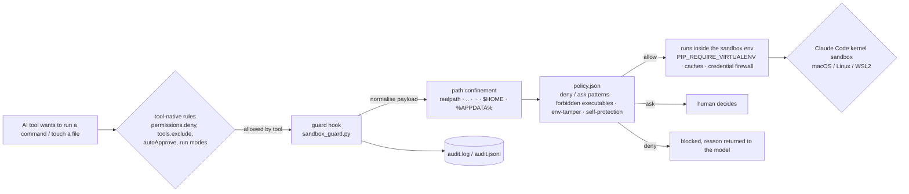

<div align="center">

# ai-sandbox (`aisb`)

**A project-local sandbox for AI coding agents.**
Claude Code · Cursor · Gemini CLI · GitHub Copilot · Google Antigravity · Windsurf / Devin · Codex · and more

*Nothing global. Every command audited. One source of truth for rules, skills, agents, MCP servers and hooks — and a one-command way to ship your whole agentic setup to someone else.*

[](https://github.com/RATEESHK/ai-sandbox/actions/workflows/ci.yml)
[](https://github.com/RATEESHK/ai-sandbox/releases)
<!-- license-badge --> [](LICENSING.md) <!-- /license-badge -->
[](docs/install.md)
[](docs/install.md)

</div>

```text
$ cd my-project
$ sh ~/ai-sandbox/install.sh                 # Windows: ai-sandbox\install.cmd   (no Python? still works)

[DONE] venv       .venv created
[DONE] wrote      .ai-sandbox/hooks/sandbox_guard.py
[DONE] wrote      CLAUDE.md · GEMINI.md · AGENTS.md · .cursor/hooks.json · .github/hooks/ai-sandbox.json · .agents/hooks.json ...
[PASS] guard      self-test selftest: 176 cases, 0 failed
[PASS] protocol   claude deny npm -g · cursor deny pip --user · gemini deny sudo · antigravity deny cd .. · copilot deny brew ...
[PASS] RESULT: PASS

$ aisb apply profile:design                  # 40 design/UI skills + Playwright & DevTools MCP, project-local, licenses recorded
$ aisb context antigravity                   # .antigravityignore so node_modules never hits the context window
$ aisb doctor antigravity --fix              # the troubleshooting checklist, local steps applied, global steps printed
$ aisb pack                                  # my-project.aisb.zip -> anyone: aisb apply my-project.aisb.zip
```

---

## Why

AI coding agents are brilliant and reckless. Left alone they `npm install -g`, `pip install --user`,
`brew install`, read `~/.ssh` and `~/.aws`, `cd ..` into your other repos, and every tool keeps its
own idea of where rules, skills, MCP servers and hooks live. Sharing a good setup means a README of
"copy this to `~/.claude`" steps that pollute the whole machine.

`aisb` fixes both problems **inside one folder**:

| Problem | What `aisb` does |
|---|---|
| Agents install things globally | A **guard hook** inspects every shell command and file operation *before* it runs, in the wire format of each tool, and denies global installs, privilege escalation, home-directory access, `..` escapes and attempts to weaken the sandbox. 38 deny patterns, 17 ask patterns, 80 forbidden executables, path confinement with real symlink/`..`/`~`/`%APPDATA%` resolution — self-tested on POSIX **and** Windows path semantics. |
| You don't know what the agent ran | `.ai-sandbox/logs/audit.log` (human) and `audit.jsonl` (machine): timestamp, tool, decision, rule, exact command/path, file hashes after edits. `aisb log --follow`. |
| Python/Node/… leak out of the project | 87 environment variables confine pip, uv, poetry, npm, pnpm, yarn, bun, cargo, go, gradle, maven, dotnet, gem, composer, terraform, Playwright, Hugging Face … caches and *user-level config files* to the project. `PIP_REQUIRE_VIRTUALENV=true` and a project `.venv`, always. |
| Cloud CLIs would use your real credentials | A **credential firewall**: `aws`, `gcloud`, `az`, `kubectl`, `helm`, `docker login`, `gh`, `gpg`, global `git config` see empty, isolated configuration under `.ai-sandbox/home/`. |
| Every tool has a different config layout | One **single source of truth** (`.ai-sandbox/`) fanned out to Claude Code, Gemini CLI, Cursor, Copilot (CLI + VS Code), VS Code, Antigravity, Windsurf/Devin, Codex, Cline, Roo, Kiro, Junie, Amazon Q, Continue, Zed and Aider. Verified against vendor docs (Oct 2026), kept in a declarative [targets registry](aisb/targets.py). |
| Sharing a setup is a pile of manual steps | **Bundles**: `aisb apply github:owner/repo` imports Claude Code plugins & marketplaces, skill-tree repos (ui-skills, claude-design-skills, Vercel agent-skills, gstack …) and `.aisb.zip` bundles — project-locally, with licenses recorded. `aisb pack` exports yours. |
| "It works on my machine" | Idempotent `init`/`sync`, a manifest of every file it created or merged, and `uninstall` that restores a pre-existing project **byte for byte**. |

## Install

Three ways, all project-local, none touching your machine:

| You have … | Run from inside your project |
|---|---|
| **Python 3.8+** | `sh /path/to/ai-sandbox/install.sh` (macOS/Linux/WSL/Git Bash) · `\path\to\ai-sandbox\install.cmd` (Windows cmd) · `powershell -NoProfile -ExecutionPolicy Bypass -File install.ps1` |
| **No Python at all** | Same scripts. They detect it and download the **standalone build** for your OS/CPU from [Releases](https://github.com/RATEESHK/ai-sandbox/releases) (SHA256-verified) into `.ai-sandbox/bin/aisb-bin/`. Only `cmd.exe` + `curl.exe`/`certutil` + `tar.exe` on Windows, only POSIX `sh` + `curl`/`wget` + `tar` elsewhere. No PowerShell, no bash required. Or download the zip yourself, unpack, run `install.cmd` from your project. |
| **uv** | `uvx --from git+https://github.com/RATEESHK/ai-sandbox aisb init` (runs from uv's cache, installs nothing) |

Then, in every terminal you start an AI tool from:

```bash
source ./.ai-sandbox/bin/activate.sh      # bash/zsh        . .\.ai-sandbox\bin\activate.ps1   # PowerShell
call .ai-sandbox\bin\activate.cmd         # cmd             -> `aisb` is now a command; .venv first on PATH
```

Start the tool **in the project folder** and accept its one-time *"trust this folder"* prompt — Claude Code,
Gemini CLI, Cursor, VS Code and Copilot only load project settings and hooks from trusted folders.
`aisb verify` must say `RESULT: PASS`. Full details, offline installs and CI usage: [docs/install.md](docs/install.md).

## What you get

```text
your-project/
├── .ai-sandbox/                 SINGLE SOURCE OF TRUTH  (commit it; machine-specific parts are git-ignored)
│   ├── rules/*.md               instructions every tool receives  (sandbox-policy.md is mandatory; add yours)
│   ├── skills/<name>/SKILL.md   Agent Skills             ├── agents/*.md      sub-agents
│   ├── commands/*.md            slash commands           ├── hooks.d/*.json   your hooks (tool-agnostic)
│   ├── mcp/servers.json         MCP servers              ├── bundles/         imported setups + bundles.lock.json
│   ├── policy.json              the enforced rules (regex, forbidden executables, protected paths)
│   ├── hooks/sandbox_guard.py   the guard (one file, stdlib, reads one JSON object, answers in each tool's protocol)
│   ├── bin/                     aisb · aisb.cmd · aisb.ps1 launchers, activate.*, aisb.pyz (or aisb-bin/ without Python)
│   ├── config/ home/ cache/     isolated pip/npm/git/kube/aws/… config, empty credentials, all caches
│   ├── runtime/                 optional project-local Python (`aisb runtime python`)
│   └── logs/audit.log + .jsonl  everything the agents did
├── .venv/                       the project Python
├── AGENTS.md  CLAUDE.md  GEMINI.md             (your own content is kept; aisb owns a marked block)
├── .claude/   settings.json · settings.local.json · skills/ · agents/ · commands/ · rules/ · .mcp.json
├── .gemini/   settings.json · .env · commands/ · agents/            .cursor/   rules/*.mdc · hooks.json · mcp.json · agents/ · commands/
├── .github/   copilot-instructions.md · instructions/ · hooks/ · agents/ · prompts/ · mcp.json
├── .vscode/   settings.json · tasks.json · mcp.json                 .agents/   skills/ · rules/ · agents/ · hooks.json · mcp_config.json  (Antigravity + cross-tool skills)
└── .devin/ + .windsurf/  rules/ · workflows/ · hooks.json
```

## How enforcement works



Five layers, each independent:

1. **Policy text in context** – `AGENTS.md`, `CLAUDE.md` import, `GEMINI.md` import, `.cursor/rules/*.mdc`, `.github/copilot-instructions.md`, `.agents/rules`, `.devin/rules` …
2. **Tool-native restrictions** – Claude Code `permissions.deny`/`disableBypassPermissionsMode`/`blockReadsOutsideWorkingDirectories`, Gemini `tools.exclude` + folder trust, VS Code/Copilot terminal approvals + `blockDetectedFileWrites`, Antigravity "Request Review" policy.
3. **The guard hook** – PreToolUse/PostToolUse in Claude, BeforeTool/AfterTool in Gemini, Cursor's `beforeShellExecution`/`beforeMCPExecution`/`beforeReadFile`/`afterFileEdit`, Copilot `preToolUse`/`postToolUse`, Antigravity `.agents/hooks.json`, Windsurf/Devin `pre_run_command` … Fail-closed: unparsable input or an internal error denies.
4. **Environment redirection** – the 87 variables, injected the way each tool supports (Claude `env` + `CLAUDE_ENV_FILE` preamble, Gemini `.gemini/.env`, Cursor `sessionStart` hook, VS Code `terminal.integrated.env.*`, your activated shell).
5. **Kernel sandbox** – Claude Code's own (`sandbox.enabled`) on macOS, Linux and WSL2 with `bubblewrap`+`socat`: workspace-only writes, credential dirs unreadable, registry allow-list.

What the guard decides (176 self-test cases, run by `aisb verify`):

| Example | Decision | Rule |
|---|---|---|
| `npm install -g typescript`, `pip install --user x`, `pipx install`, `uv tool install`, `cargo install` | deny | global install (relaxed automatically when the sandbox env redirects the tool inside the project, e.g. `CARGO_HOME`) |
| `sudo …`, `brew`, `apt`, `winget`, `choco`, `setx`, `reg add`, `crontab`, `systemctl`, `nvm`, `corepack` | deny | forbidden executable |
| `cat ~/.ssh/id_rsa`, `cd ..`, `cp a.txt /tmp/`, `git clone … ../x`, `tar -xzf a.tgz -C ../out`, `docker run -v /:/host` | deny | path confinement |
| `unset PIP_REQUIRE_VIRTUALENV`, `pip --isolated`, `env -i`, `curl … \| sh`, `iex (iwr …)` | deny | env tamper / unauditable installer |
| `rm -rf .ai-sandbox/hooks`, editing `.claude/settings.json` or `.cursor/hooks.json` | deny | self-protection (`CLAUDE.md`, `AGENTS.md`, `.gitignore` → ask) |
| `aws s3 ls`, `kubectl get pods`, `ssh host`, `git push --force`, `npm publish`, `rm -rf .`, `eval` | ask | external side effect (cloud CLIs are allowed once the credential firewall is active in that process) |
| `./.venv/bin/python -m pip install x`, `npm ci`, `git status`, `pytest`, `cat /etc/hosts`, `make -C src` | allow | — |

## Commands

| Command | What it does |
|---|---|
| `aisb init` | Create or refresh the sandbox in the current folder. Idempotent. Ends with `verify`. Flags: `--tools claude,cursor,…\|all`, `--profile design`, `--no-venv`, `--no-credential-firewall`, `--isolate-tool-homes`, `--no-os-sandbox`, `--dry-run`, `--force` |
| `aisb sync` | Regenerate every tool file from `.ai-sandbox/` after you edit rules, policy, skills … (never overwrites your SSOT edits) |
| `aisb verify` | Prove it: real venv, guard self-test, 20+ protocol smoke tests across the tool formats, system-pip refusal, drift of generated files, JSON validity, env sanity, kernel-sandbox availability, user-level configs that would merge (`~/.claude/settings.json` with `disableAllHooks` is flagged) |
| `aisb status` · `aisb log [-n 50] [--follow] [--denied] [--json]` | Summary · audit trail |
| `aisb add mcp\|skill\|rule\|agent\|command\|hook …` · `aisb remove …` · `aisb list` | Manage the SSOT; `sync` runs automatically. Hook commands are checked by the guard before they are registered. |
| `aisb apply <source>` | Import a bundle / plugin / marketplace / skill pack / profile: local dir or `.aisb.zip`, `github:owner/repo[/sub][@ref]`, `https://…`, `profile:design`, `productivity@knowledge-work-plugins`. `--plugin a,b`, `--only skills,commands`, `--yes` (accept hooks), `--enable-mcp` |
| `aisb pack` | Export this project's agentic setup as `<name>.aisb.zip` (MCP secrets replaced by `${VAR}`) |
| `aisb context <tool\|all>` | Write the tool's ignore file(s) — `.cursorignore`, `.antigravityignore`, `.geminiignore`, `.devinignore`, Claude `Read(...)` deny rules, VS Code excludes … — **only when you ask**. Groups: deps, build, caches, secrets, lockfiles, media, data, minified, vcs |
| `aisb doctor <tool> [--fix] [--disable-mcp a,b]` | One command per tool: local fixes applied inside the project, global steps (fresh chat shortcut, model switch, reset onboarding, antivirus, cache paths) printed for you — never executed |
| `aisb runtime python [--version 3.12]` | Project-local CPython (pinned [python-build-standalone](https://github.com/astral-sh/python-build-standalone) build, SHA256-verified) + `.venv` from it. For machines without Python, or pinned interpreters per project |
| `aisb clean --src\|--cache\|--logs\|--all` | Reclaim space: fetched bundle sources (re-fetched on demand), tool caches, audit logs |
| `aisb uninstall [--purge-venv]` | Remove exactly what `init` created; strip our keys/blocks from files it merged into; restore originals |
| `aisb targets` | Supported tools and what is generated for each |

## Ship your agentic setup

The same `.ai-sandbox/` that protects you is a portable, inspectable package of **everything an agent
needs**. Three ways in, one way out:

```bash
aisb apply profile:design                      # built-in recipe: 7 design/UI skill packs + Playwright/DevTools MCP + a design-workflow rule
aisb apply profile:motion-design               # Remotion + HyperFrames + animation skills, the "motion studio" course, project-local
aisb apply profile:boris-workflow              # verification-first working agreement, read-only reviewer, build-validator, /commit-push-pr
aisb apply profile:voice                       # dictation + voice-mode instructions, Claude Code voice dictation enabled for the project
aisb apply productivity@knowledge-work-plugins # one plugin from Anthropic's marketplace (Apache-2.0)
aisb apply github:ibelick/ui-skills            # any repo with SKILL.md folders (ui-skills.com)
aisb apply github:anthropics/skills/skills/frontend-design
aisb apply github:garrytan/gstack --only skills  # skill documents only: gstack's own ./setup is global by design
aisb apply ./team-setup.aisb.zip               # a bundle a colleague made with `aisb pack`
```

Every import records the source, commit and **license** in `.ai-sandbox/bundles/bundles.lock.json`,
imports MCP servers *disabled* and hooks only with `--yes`, namespaces plugin commands (`/sales:call-prep`)
and is idempotent (re-apply = update). `aisb remove bundle <name>` takes it all out again.
Write your own bundle or profile: [docs/bundles.md](docs/bundles.md).

### Skills, instructions, agents, commands, hooks, MCP, voice

| Component | Where you put it | Where it lands |
|---|---|---|
| Rule (instruction) | `.ai-sandbox/rules/<name>.md` — frontmatter `description`, `globs` (file-scoped), `tools` | `AGENTS.md` block, `CLAUDE.md` import / `.claude/rules`, `GEMINI.md` import, `.cursor/rules/*.mdc`, `.github/instructions/*.instructions.md`, `.agents/rules`, `.devin/rules`, Kiro steering, Continue, Cline, Roo, Junie, Zed, Aider |
| Skill | `.ai-sandbox/skills/<name>/SKILL.md` | `.claude/skills/` + `.agents/skills/` (read by Claude Code, Cursor, Copilot/VS Code, Gemini CLI, Antigravity, Codex) |
| Sub-agent | `.ai-sandbox/agents/<name>.md` (Claude frontmatter) | `.claude/agents`, `.gemini/agents` (`kind: local`), `.cursor/agents`, `.github/agents/*.agent.md`, `.agents/agents` (Antigravity) |
| Command | `.ai-sandbox/commands/<name>.md` (`$ARGUMENTS`) | `.claude/commands` (`/name`), `.gemini/commands/*.toml` (`{{args}}`), `.cursor/commands`, `.github/prompts/*.prompt.md`, `.devin/workflows` |
| Hook | `.ai-sandbox/hooks.d/<name>.json` — `event: pre-tool\|post-tool\|session-start\|session-end\|prompt\|stop`, `matcher`, `command`, `tools` | Claude `settings.local.json`, Gemini `settings.json`, `.cursor/hooks.json`, `.github/hooks`, `.agents/hooks.json`, `.devin/hooks.json` — next to the guard |
| MCP server | `.ai-sandbox/mcp/servers.json` via `aisb add mcp` | `.mcp.json` (Claude), `.cursor/mcp.json`, `.vscode/mcp.json`, `.github/mcp.json` (Copilot, `type: local`), `.gemini/settings.json`, `.agents/mcp_config.json` (Antigravity), Roo/Kiro/Junie files, sidecars for tools with global-only MCP config (Windsurf/Devin, Codex TOML). Claude pre-approves exactly the servers you added (`enabledMcpjsonServers`). |
| Voice / dictation instructions | `aisb apply profile:voice` → `rules/dictation.md`, `rules/voice-mode.md` | delivered as instructions to every tool (none of them has a native "dictation instructions" setting); Claude Code `voice` settings enabled per project |

```bash
aisb add mcp playwright --command "npx -y @playwright/mcp@latest"               # local (stdio) server, project cache
aisb add mcp github --url https://api.githubcopilot.com/mcp/ --header "Authorization: Bearer \${GITHUB_TOKEN}"
aisb add rule testing --text "- run ./.venv/bin/python -m pytest before finishing"
aisb add rule css --globs "src/**/*.css" --text "- CSS modules only, no inline styles"
aisb add agent reviewer --description "Read-only code reviewer"     # writes a template to edit
aisb add command deploy-check --description "Pre-deploy checklist"
aisb add hook format --event post-tool --matcher "Write|Edit" --command "npx prettier --write ." --tools claude,cursor
```

More on MCP (custom servers, public servers, secrets, enabling/disabling, per-tool quirks): [docs/mcp.md](docs/mcp.md).

## Keep the context lean, fix a tool in one command

```bash
aisb context cursor          # .cursorignore            aisb context antigravity   # .antigravityignore (+ reminder: Strict Mode uses .gitignore)
aisb context claude          # Read(...) deny rules      aisb context all           # every tool in this project
aisb context all --groups deps,build,caches,secrets,media --add "fixtures/**"
```

Nothing is written until you run it — some teams *want* `node_modules` indexed.

```text
$ aisb doctor antigravity --fix
LOCAL (inside this project - aisb can do these)
  [x] Optimize project context: write .antigravityignore ...                 -> done
  [x] Rotate the sandbox audit logs if they are large                          -> nothing to rotate
  [x] Validate every generated config file for this tool                      -> ok
MANUAL (outside this project - aisb never touches these)
  - Start a fresh conversation: Ctrl+N (Windows/Linux) or Cmd+N (macOS) ...
  - Switch models temporarily: pick a Flash variant, send one short message, switch back ...
  - Command Palette -> 'Antigravity: Reset Onboarding' (also: Developer: Reload Window, MCP: Restart All Servers)
  - Windows: check your antivirus has not quarantined the language server: %LOCALAPPDATA%\Programs\Antigravity IDE\...\language_server_windows_x64.exe
  - Clear the app cache/logs yourself if problems persist:  ~/.gemini/antigravity  ~/.config/Antigravity  (sizes shown)
```

`aisb doctor cursor|claude|gemini|copilot|windsurf|vscode …` have their own playbooks. See [docs/troubleshooting.md](docs/troubleshooting.md).

## Supported tools

| Target | Rules | Skills | Agents | Commands | MCP (project) | Hooks | Ignore |
|---|---|---|---|---|---|---|---|
| **claude** Claude Code | `CLAUDE.md` import, `.claude/rules` | `.claude/skills` | `.claude/agents` | `.claude/commands` | `.mcp.json` | `settings.local.json` (exec form) | `permissions.deny Read(...)` |
| **gemini** Gemini CLI | `GEMINI.md` import | `.agents/skills` | `.gemini/agents` | `.gemini/commands/*.toml` | `.gemini/settings.json` | `.gemini/settings.json` | `.geminiignore` |
| **cursor** | `.cursor/rules/*.mdc` | `.claude/skills`, `.agents/skills` | `.cursor/agents` | `.cursor/commands` | `.cursor/mcp.json` | `.cursor/hooks.json` | `.cursorignore` |
| **copilot** CLI · VS Code agent · coding agent | `.github/copilot-instructions.md`, `.github/instructions` | `.claude/skills`, `.agents/skills` | `.github/agents/*.agent.md` | `.github/prompts` | `.github/mcp.json` (`type: local`) | `.github/hooks/*.json` (bash + powershell) | — (org-level content exclusion) |
| **vscode** | — | — | — | — | `.vscode/mcp.json` | — | `files/search.exclude` |
| **antigravity** App · IDE · CLI | `.agents/rules` (`trigger:`) | `.agents/skills` | `.agents/agents` | — (workflows retired → skills) | `.agents/mcp_config.json` | `.agents/hooks.json` | `.antigravityignore` + Strict Mode `.gitignore` |
| **windsurf** / Devin Desktop | `.devin/rules` + `.windsurf/rules` | — | — | `.devin/workflows` | sidecar (global-only) | `.devin/hooks.json` + legacy | `.devinignore`, `.codeiumignore` |
| codex · cline · roo · kiro · junie · amazonq · continue · zed · aider | rules in each tool's location | codex: `.codex/skills` | | | roo, kiro, junie, zed, codex (TOML sidecar) | | `.clineignore` `.rooignore` `.kiroignore` `.aiignore` `.continueignore` `.aiderignore` |

Facts were verified against vendor documentation in October 2026 and live in [aisb/targets.py](aisb/targets.py)
with `confidence` notes; `aisb targets` prints the live table. Vendors rename things monthly — a
[tool-format-change issue](.github/ISSUE_TEMPLATE/tool_format_change.yml) with the doc URL is the most useful contribution you can make.

## Honest limits

- The guard is **static analysis** of command strings and tool arguments (it unwraps `bash -c`, `cmd /c`,
  `powershell -Command`, scans inline `python -c`/`node -e` for outside paths). A program the agent writes and
  then runs is opaque to it. Claude Code's kernel sandbox is the only hard write barrier; native Windows has none.
- Hooks run only where the tool loads them: open the project **root** and trust it. `aisb verify` checks the
  files and wire formats, not the live tool — for a live proof, ask the agent to run `npm install -g left-pad`
  and watch `aisb log --follow`.
- Tools decide what reaches hooks; MCP calls are logged and allowed by default (`"mcp_tools": "ask"` in `policy.json` to prompt).
- Ignore files are best-effort per the vendors' own docs (`.cursorignore` cannot block terminal or MCP access).
- CI runs the test suite and the bootstraps on Windows, macOS and Linux runners; development and the no-Python flow were exercised end to end on Linux.

## Project layout of this repository

```text
aisb/            the package: cli · guard (hook) · targets (registry) · generators · installer · verifier · uninstaller
                 ssot · components · bundles · context · doctor · runtime · envmodel · templates · profiles/*.json
install.sh / install.cmd / install.ps1   bootstraps (POSIX sh / cmd.exe / PowerShell)
scripts/build.py                          zipapp (aisb.pyz), PyInstaller standalone build, release assets + SHA256SUMS
tests/                                    guard protocol tests + end-to-end CLI tests (run on Linux, macOS, Windows in CI)
docs/                                     architecture · install · targets · mcp · bundles · policy · troubleshooting · faq
```

## Contributing

Issues and pull requests are welcome — especially verified tool-format changes, new targets, guard rules
with self-test cases, and profiles with clear licenses. Read [CONTRIBUTING.md](CONTRIBUTING.md); the CLA bot
will ask you to sign [CLA.md](CLA.md) on your first PR.

## License

<!-- license-section -->
**Free and open source under the [GNU Affero General Public License v3.0 or later](LICENSE) — or a [commercial license](COMMERCIAL-LICENSE.md) if you want to ship it closed.**

- **Everyone** — individuals, companies, client work, CI — may use it free of charge, including at work. Keep `LICENSE` and `NOTICE` with any copy.
- **Forks and modified versions** are welcome; the AGPL requires them to stay open (source under the same license), to be marked as modified, and to keep the author attribution in [`NOTICE`](NOTICE).
- **Companies** that want to bundle a modified version in a proprietary product or service without releasing the source get a commercial license — paid, **or free in exchange for contributing to or maintaining the project** ([COMMERCIAL-LICENSE.md](COMMERCIAL-LICENSE.md)).
- Using it? Add yourself to [ADOPTERS.md](ADOPTERS.md) — it is how the project gets known and maintained.

Details: [LICENSING.md](LICENSING.md) · single-maintainer model: [GOVERNANCE.md](GOVERNANCE.md) · contributions: [CLA.md](CLA.md). Skill packs and plugins you import keep their own licenses, which `aisb` shows and records.
<!-- /license-section -->

---

<sub>Keywords: AI coding agent sandbox · Claude Code hooks · Claude Code sandbox · Cursor hooks · Gemini CLI hooks · GitHub Copilot hooks ·
Google Antigravity rules and MCP · Windsurf Cascade hooks · MCP server configuration per project · Agent Skills SKILL.md · AGENTS.md ·
prevent npm install -g · pip require virtualenv · PreToolUse guard · audit log for AI agents · ship agentic setups · project-local Python runtime</sub>
