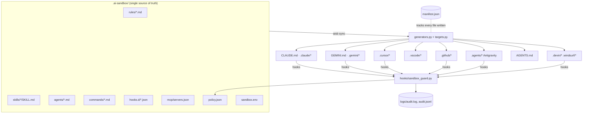

# Architecture

ai-sandbox has three moving parts: a **single source of truth** on disk, a set of **generators** that
project it into each tool's native format, and a **guard** that every tool calls before and after each
action. Everything lives in the project folder; nothing is ever written outside it.

## 1. The SSOT (`.ai-sandbox/`)

| Path | Role |
|---|---|
| `rules/*.md` | Instructions. `sandbox-policy.md` is generated once and then yours (never overwritten without `--force`). Optional frontmatter: `description`, `globs`/`paths` (file-scoped), `always`, `tools` (limit fan-out), `order`. |
| `skills/<name>/SKILL.md` | [Agent Skills](https://agentskills.io). Copied verbatim; the folder name must equal the frontmatter `name` (the importer fixes this). |
| `agents/<name>.md` | Sub-agents in Claude Code's frontmatter dialect (`name`, `description`, `tools`, `model`). Converted per tool (Gemini `kind: local`, Antigravity `commandExecutionPolicy`, Cursor `readonly`, Copilot `.agent.md`). |
| `commands/<name>.md`, `commands/<ns>/<name>.md` | Slash commands (`$ARGUMENTS`). Namespaces map to `/ns:name` in Claude Code and Gemini CLI, `ns-name` elsewhere. |
| `hooks.d/<name>.json` | Your hooks in a tool-agnostic schema: `{"event": "pre-tool|post-tool|session-start|session-end|prompt|stop", "matcher": "Write|Edit", "command": "...", "timeout": 30, "tools": ["claude"]}`. |
| `mcp/servers.json` | MCP servers: `{"servers": {"name": {"transport": "stdio|http|sse", "command", "args", "env", "url", "headers", "enabled"}}}`. |
| `policy.json` + `policy.local.json` | The enforced rules. `policy.json` is portable and committable; `policy.local.json` holds this machine's `protected_env_vars` and `home_prefixes`. Lists are concatenated. |
| `sandbox.env` | The generated environment (absolute paths, this machine). Source of `activate.*`, `.gemini/.env`, Claude's `env` block and the `CLAUDE_ENV_FILE` preamble. |
| `bundles/bundles.lock.json` + `bundles/_src/` | Provenance of every imported bundle (source, commit, license, components) and the fetched sources (git-ignored). |
| `manifest.json` + `backup/` | Every file aisb wrote: mode (`generated` / `merged` / `block`), SHA-256, whether it existed before, which JSON keys/list items we own, originals for restore. |

## 2. Generators and the targets registry

`aisb/targets.py` is a declarative table: for each tool, where rules, skills, agents, commands, MCP servers,
hooks and ignore files live, the trust model, the vendor doc URL and a `confidence` note. `aisb/generators.py`
turns the SSOT into those files. Three write primitives (in `manifest.py`) make every write reversible:

- **`put`** – a file aisb owns entirely. If a foreign file existed it is backed up first; if you modify a
  generated file later, sync keeps your version and warns (`--force` regenerates).
- **`merge_json`** – deep-merge our keys into an existing JSON/JSONC file. We own *leaves* and *list items*,
  never containers, so your keys survive and `uninstall` removes exactly ours (and restores overwritten values).
- **`put_block`** – a marked block (`<!-- ai-sandbox:begin/end -->` or `# >>> ai-sandbox >>>`) appended to
  Markdown/ignore files; refreshed in place, removed on uninstall.

`aisb sync` is idempotent: re-running it changes no bytes (CI asserts this on all three OSes).

## 3. The guard (`hooks/sandbox_guard.py`)

One stdlib-only file. It reads **one JSON object** on stdin, normalises it (every tool has a different
shape — `tool_name/tool_input`, `toolName/toolArgs` (string or object), `command/cwd`, `toolCall.args.CommandLine`,
`tool_info.command_line`), evaluates it and answers in the caller's protocol:

| `--tool` | allow | ask / deny |
|---|---|---|
| `claude` | silent, exit 0 | `{"hookSpecificOutput": {"hookEventName": "PreToolUse", "permissionDecision": "deny|ask", "permissionDecisionReason": ...}}` |
| `gemini` | silent | `{"decision": "deny", "reason": ..., "systemMessage": ...}` (no ask channel → `ask_fallback`) |
| `cursor` | `{"permission": "allow"}` (JSON always) | `{"permission": "deny|ask", "user_message", "agent_message"}`; `beforeSubmitPrompt` → `{"continue": true}` |
| `copilot` | silent | `{"permissionDecision": "deny|ask", "permissionDecisionReason": ...}` (+ `hookSpecificOutput` mirror for the VS Code local harness) |
| `antigravity` | `{"decision": "allow"}` | `{"decision": "deny|ask", "reason": ...}`; post events `{}` |
| `windsurf` / `generic` | exit 0 | stderr reason + exit 2 |

Evaluation order: cwd must be inside the root → MCP policy → every path argument (file tools) → every
command (`split_segments` on `; && || | &`, quote-aware `tokenize`, redirections, env assignments, wrappers
like `env`/`nohup`/`xargs`, inline shells unwrapped, inline interpreters scanned, per-command intent tables
for write/read/enter, docker mounts, git subcommands) → policy patterns (`deny_patterns`, `ask_patterns`
with `unless` and `unless_env_inside_root`) → env-tamper detection → dotfile references. The strongest
decision wins (deny > ask > allow); every reason and rule id is logged.

Path classification resolves `~`, `~user`, `$VAR`, `${VAR}`, `$env:VAR`, `%VAR%` from the hook's own
environment, then `realpath`. Inside the root: allowed unless it touches a protected path. Outside: deny
for writes and `cd`, deny for anything under a home prefix or reached via `..`, allow reads under known
system prefixes, otherwise ask. Both POSIX and Windows semantics are implemented (`ntpath`/`posixpath`,
case folding, drive letters, UNC) and exercised by `--selftest` on every platform.

Fail-closed: unparsable input, an internal error or a policy regex error all resolve to deny/ask per
`policy.json` (`on_unparsable_input`, `on_internal_error`, `ask_fallback`).

## 4. Runtime modes

| Mode | When | Hooks run as |
|---|---|---|
| **python** | a Python ≥ 3.8 exists, or `aisb runtime python` installed one | `<project>/.venv/bin/python .ai-sandbox/hooks/sandbox_guard.py --tool X --event Y` |
| **binary** | installed from the standalone build (no Python) | `<project>/.ai-sandbox/bin/aisb-bin/aisb guard --tool X --event Y` |

Claude Code hooks use the **exec form** (`command` + `args`, no shell) so quoting is identical under `sh`,
Git Bash and PowerShell. Tools that only take a command string get a relative command (Cursor, Copilot,
Windsurf — run from the project root) or an env-var-rooted one (`$GEMINI_PROJECT_DIR`), with a PowerShell
variant where the tool runs hooks through PowerShell on Windows.

The in-project launchers `.ai-sandbox/bin/aisb` (POSIX sh), `aisb.cmd`, `aisb.ps1` pick the runtime in this
order: `aisb-bin/` → `.venv` → `.ai-sandbox/runtime/python` → `python3`/`python`/`py -3` on PATH. They never
install anything.

## 5. Environment model (`envmodel.py`)

Tier 1 confines language tooling (pip, uv, poetry, pipenv, pipx, npm/pnpm/yarn/bun/deno, cargo, go, gradle,
maven, nuget/dotnet, gem/bundler, composer, terraform, Playwright, Puppeteer, Cypress, HF/Torch/Keras, temp
dirs, telemetry opt-outs). Tier 2 is the credential firewall (`GIT_CONFIG_GLOBAL`, `KUBECONFIG`, `AWS_*`,
`CLOUDSDK_CONFIG`, `AZURE_CONFIG_DIR`, `DOCKER_CONFIG`, `GH_CONFIG_DIR`, `TF_CLI_CONFIG_FILE`, `HELM_*`,
`GNUPGHOME`, `XDG_*`) — applied inside the tools, and in your shell only with `AI_SANDBOX_STRICT=1`.
Tier 3 (`--isolate-tool-homes`) moves `CLAUDE_CONFIG_DIR`, `GEMINI_CLI_HOME` and `COPILOT_HOME` into the project.

The guard knows these variables (`protected_env_vars`) and denies any attempt to unset or override them;
several deny rules relax when the corresponding variable points inside the root (proof that the sandbox
environment is active in that process).
